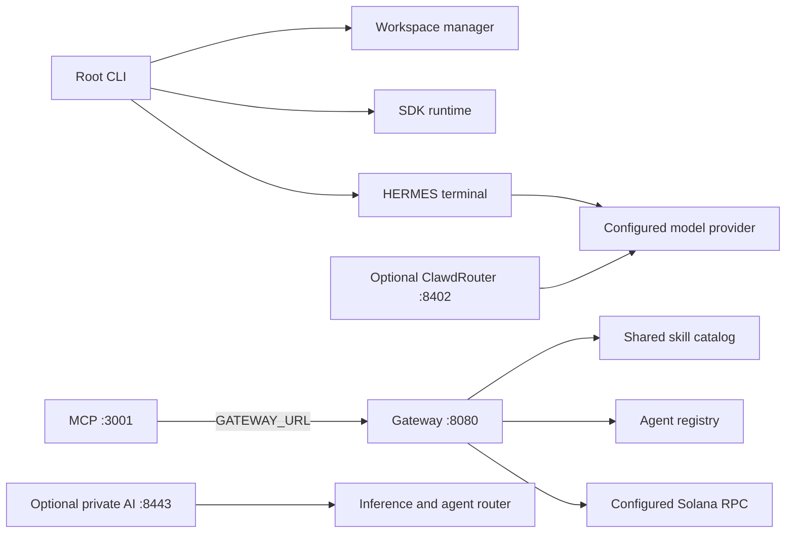

# Working together locally

Use Node 22 (`nvm use`). The component inventory and dependency graph live in
[`workspace.components.json`](../workspace.components.json). Paths stay in place so
existing imports, submodules, and external checkouts keep their identity.

```bash
npm run setup                         # install, build, then typecheck the core
npm run workspace -- list             # every component and its role
npm run workspace:doctor              # static integrity and optional readiness
npm run workspace -- plan services --task build
```

Setup uses package-local lockfiles with lifecycle scripts disabled. Native addons
required by an optional runtime need their own explicit setup. It creates a root
`.env` template only when none exists; it preserves existing environment files.

```bash
npm run stack                         # gateway + MCP, one process owns both
npm run stack:check                   # isolated integration check, then shuts down
npm run demo                          # local simulated buddy and tool catalog
npm run hermes                        # terminal, provider configuration required for AI
```

The stack loads the root `.env`, binds both services to loopback, waits for their
health endpoints, and shuts both down on Ctrl+C or a child failure. Ports can be
changed with `GATEWAY_PORT` and `MCP_PORT`; MCP receives the corresponding
`GATEWAY_URL`. Starting the stack does not start the router or trading loops.
Telegram polling and Birdeye subscriptions require `GATEWAY_BACKGROUND_ENABLED=true`.



## Verification profiles

| Profile | Components | Command |
| --- | --- | --- |
| `core` | SDK, root CLI, router, Leviathan, MCP, gateway, terminal | `npm run workspace:install` |
| `services` | Core plus AMM and perps aggregator | `npm run workspace -- install services` |
| `packages` | Reusable wallet, SDK, perps, runtime and CLI packages | `npm run workspace -- install packages` |
| `attestation` | Private AI terminal, inference and agent router | `npm run workspace -- install attestation` |

For a selected profile, run `build` before `check` because the root facade consumes
SDK declarations:

```bash
npm run workspace -- verify services --task build
npm run workspace -- verify services --task check
npm test
npm run router:test
npm run stack:check
```

`npm run smoke:readme` combines the services build and typechecks, workspace tests,
and Gateway-to-MCP smoke check. It expects the services profile to be installed;
it does not install packages during verification. Failures stop dependent builds
and return a failing exit code. Inspect the plan before running optional profiles.

The integration check uses ephemeral ports and a controlled environment. It
initializes a real MCP client, discovers its tools, reads gateway health and the
skill catalog through those tools, and requests integration status. It performs
no inference, bot polling, wallet signing, payments, deployment, or external RPC
requests. A passing check establishes those local connections; credentials and
external providers require their own live verification.

## Configuration

[`.env.example`](../.env.example) documents shared names. Keep credentials local.
Direct package commands use their package's normal environment loading; `npm run
stack` loads the root file explicitly. Root example defaults to devnet. Live
wallet actions remain separate and require their existing review/approval flows.

| Surface | Address / configuration |
| --- | --- |
| MCP HTTP | `http://127.0.0.1:3001/mcp`, `MCP_PORT`, optional `MCP_API_KEY` |
| Gateway | `http://127.0.0.1:8080`, `GATEWAY_PORT`, `SOLANA_RPC_URL` |
| MCP → gateway | `GATEWAY_URL`, also accepts `CLAWD_GATEWAY_URL` |
| Router | `CLAWDROUTER_PORT` (8402); start explicitly with `npm run router:start` |
| TEE terminal | `TEE_PORT` (8443); explicit demo/live configuration in its README |

## Optional and upstream components

Rust/Anchor programs, Lean proofs, Python agents, Swift apps, browser extensions,
ADK/A2A projects, preserved upstream trees, and uninitialized submodules are listed
in the inventory. They are not all one Node application. Use their own manifests
and readmes to select toolchains and checks. `doctor` distinguishes required
integrity failures from optional components that have not been initialized.

The current `dark-defi/` is a separate DarkRalph application. Old references to
missing `dark-defi/packages/*` packages have been removed from root installation
and exports. The SDK's legacy private-protocol adapter reports missing optional
provider packages explicitly; the current app does not implement that old SDK.

Submodules are opt-in: inspect `.gitmodules` and initialize only the intended
paths. Private `gitlawb://` entries need their own access/tooling. Existing deleted
checkouts are not restored by setup. No command here deploys a service or submits
a chain transaction.
